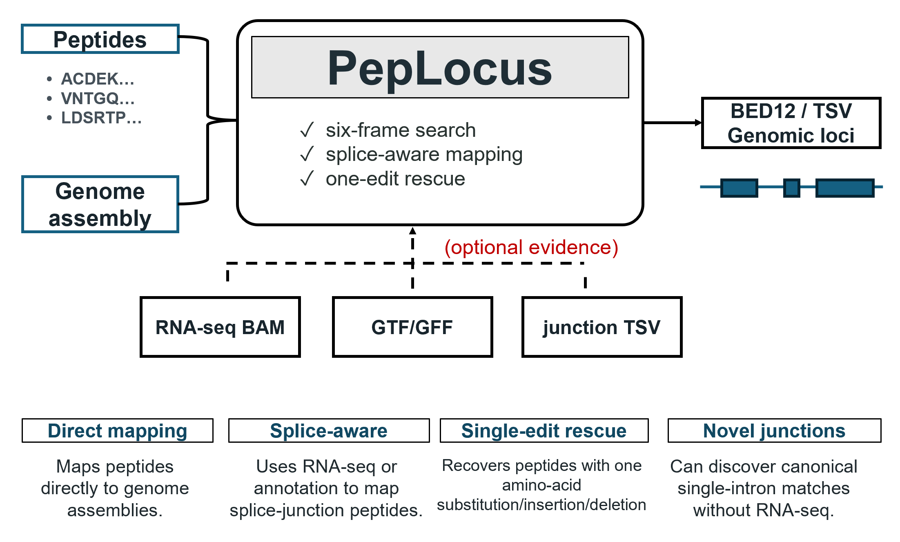

# PepLocus

Map mass-spectrometry peptides directly to eukaryotic genome assemblies, including splice-junction peptides. PepLocus searches all six reading frames, always treats I/L as equivalent, and can use GTF/GFF annotations or RNA-seq BAM evidence.



## Install

Requires Python 3.9 or newer. Linux and macOS are recommended.

```bash
python -m pip install "git+https://github.com/qussai96/PepLocus.git"
```

Once published on PyPI:

```bash
python -m pip install peplocus
```

Dependencies are installed automatically; no external aligner is needed.

## Run

Map a peptide list to an assembly:

```bash
peplocus -a assembly.fa -p peptides.tsv --out results
```

Add annotation and/or RNA-seq evidence to find splice-junction placements:

```bash
peplocus -a assembly.fa -p peptides.tsv -g models.gtf -b rnaseq.bam --out results_spliced
```

`-g` accepts GTF or GFF. Either `-g` or `-b` can be used alone. A BAM index is not required.

Optional one-edit rescue searches peptides with no exact match for one amino-acid substitution, insertion or deletion:

```bash
peplocus -a assembly.fa -p peptides.tsv -g models.gtf --rescue-one-edit --out results_rescue
```

The default is **8 workers** (`--threads`). Rescue uses a minimum query length of **9 aa**; short candidates can be highly ambiguous. Use `--min-rescue-length 12` for a more conservative search. `--discover-junctions` optionally searches for bounded canonical single-intron matches without supplied evidence.

Peptides can be a plain list, FASTA, CSV or TSV; FragPipe's `Peptide Sequence` column is recognised automatically. Assembly FASTA may be plain or gzip-compressed. Use a fresh output directory for each run.

```bash
peplocus -h
```

## Results

| File | Contents |
|---|---|
| `all_mappings.bed` | Exact and I/L-equivalent placements |
| `tryptic_mappings.bed` | Placements with compatible tryptic or possible protein-terminal contexts |
| `mappings.tsv` | Coordinates, sequences, evidence, cleavage contexts and mapping counts |
| `peptides.tsv` | Per-peptide exact and rescue counts and status |
| `unmapped.tsv` | Peptides with no exact match, including labeled rescue candidates |
| `summary.json` | Parameters, counts, timings and search limits |

BED files use standard BED12 coordinates, with peptide names in biological N-to-C orientation on both strands. Rescue candidates are kept separately in `rescue/`, with their own all/tryptic BED files and detailed TSV. A reusable `junctions.tsv` is also saved when splice evidence is supplied.

Contiguous matching is exhaustive for the chosen translation table. Splice mapping depends on available junctions and search limits. Placements show sequence compatibility; one-edit candidates are not confirmed variants, and tryptic compatibility alone does not establish biological origin.

[Report an issue](https://github.com/qussai96/PepLocus/issues) · [MIT license](https://github.com/qussai96/PepLocus/blob/main/LICENSE)
